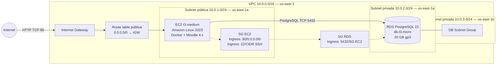

# Template: Design de Arquitetura

> **Instruções:**
> 1. Faça uma cópia deste arquivo com o nome `docs/architecture-design.md` — **esse é o arquivo que você deve entregar**.
> 2. Preencha cada seção substituindo os blocos `<!-- TODO: ... -->` pelo conteúdo real da sua solução.
> 3. Não apague os títulos das seções — eles são verificados automaticamente na avaliação.
> 4. O diagrama deve cobrir, no mínimo: VPC, subnets públicas e privadas, EC2, RDS, Security Groups e o fluxo Internet → IGW → EC2 → RDS.

---

## Visão Geral

A solução provisiona uma plataforma Moodle 4.x na AWS usando Terraform modular na região `us-east-1`. A infraestrutura é composta por uma VPC com segmentação entre uma subnet pública e duas subnets privadas, uma instância EC2 Amazon Linux 2023 que executa Moodle em contêineres Docker e um banco RDS PostgreSQL 15 gerenciado pela AWS.

A instância EC2 usa o tipo `t3.medium` e fica na subnet pública `10.0.1.0/24` (`us-east-1a`). No primeiro boot, o `user_data.sh` atualiza o sistema, instala Docker e Docker Compose, espera o RDS ficar disponível e inicia o serviço Moodle pela porta 80. O Moodle persiste os dados em volumes Docker locais e armazena o conteúdo relacional no PostgreSQL.

O RDS usa a classe `db.t3.micro`, 20 GB de armazenamento gp3 e fica em subnets privadas nas zonas `us-east-1a` e `us-east-1b`. O banco recebe apenas conexões TCP na porta 5432 originadas pelo Security Group da EC2. A arquitetura foi dimensionada para ambiente educacional do AWS Learn Lab, priorizando baixo custo, simplicidade operacional e restrição de rede sem criar recursos IAM adicionais.

## Diagrama de Arquitetura

O diagrama representa a VPC `10.0.0.0/16`, o Internet Gateway, a route table pública e o caminho `Internet → IGW → EC2` pela porta HTTP 80. Da EC2, o Moodle se comunica exclusivamente pela porta 5432 com o RDS PostgreSQL em subnets privadas. O Security Group da EC2 permite HTTP público e SSH apenas pelo CIDR configurado; o Security Group do RDS aceita PostgreSQL somente quando a origem é o Security Group da EC2.

## Decisões de Design

| Componente | Escolha | Justificativa |
|---|---|---|
| Tipo de instância EC2 | `t3.medium` | Fornece 2 vCPUs e 4 GB de memória, recursos adequados para Moodle em carga educacional e mais estáveis que tipos menores para o boot com Docker e inicialização da aplicação. |
| Engine do banco de dados | RDS PostgreSQL 15 | PostgreSQL oferece compatibilidade com Moodle, está disponível no ambiente de laboratório e é coerente com o contêiner PostgreSQL 15 usado nas verificações locais. |
| Classe da instância RDS | `db.t3.micro` | É uma opção de menor porte e custo compatível com carga baixa de estudo. Embora tenha limites menores que uma instância de produção, atende ao objetivo e às restrições do crédito do Learn Lab. |
| AMI da EC2 | Amazon Linux 2023 | AMI atualizada e mantida pela AWS, com suporte a `dnf`, Docker e configuração automatizada por `user_data.sh`. |
| Topologia de rede | 1 subnet pública + 2 privadas | A EC2 precisa de acesso público na porta 80 e pode receber SSH restrito. O RDS fica sem IP público em subnets privadas; a segunda AZ é exigida pelo DB Subnet Group. |
| Acesso IAM na EC2 | LabRole via data source | O AWS Learn Lab não permite criar roles ou instance profiles. O Terraform referencia `LabInstanceProfile` já existente com `data "aws_iam_instance_profile"`, evitando mudanças de IAM proibidas. |
| Armazenamento EC2 | 30 GB gp3 criptografado | O disco foi dimensionado para o sistema, imagens Docker e volumes locais do Moodle, oferecendo criptografia e expansão simples em relação ao volume padrão. |
| Armazenamento RDS | 20 GB gp3, expansão até 40 GB | O volume inicial atende à carga de estudo, enquanto `max_allocated_storage` permite expansão automática até o dobro sem substituição da instância. |
| Alta disponibilidade | Não configurada nesta versão | O ambiente didático usa uma EC2 em uma AZ e RDS com `multi_az` desativado, reduzindo custo e sendo compatível com os limites do Learn Lab. |

## Componentes

### VPC

A VPC `aws_vpc.main` usa o identificador gerado pela AWS e o CIDR `10.0.0.0/16`, na região `us-east-1`. DNS hostnames e DNS support estão habilitados, permitindo que os recursos usem nomes privados da AWS. A VPC é marcada com o nome `moodle-vpc` e as tags de ambiente, projeto e gerenciamento.

### Subnets

| Subnet | Tipo | CIDR | Zona de disponibilidade | Recursos |
|---|---|---|---|---|
| `moodle-subnet-public-us-east-1a` | Pública | `10.0.1.0/24` | `us-east-1a` | EC2 Moodle |
| `moodle-subnet-private-us-east-1a` | Privada | `10.0.2.0/24` | `us-east-1a` | RDS PostgreSQL primário |
| `moodle-subnet-private-us-east-1b` | Privada | `10.0.3.0/24` | `us-east-1b` | Segunda subnet do DB Subnet Group |

A subnet pública habilita IP público automático. As subnets privadas não têm rota direta para um Internet Gateway e o RDS é configurado com `publicly_accessible = false`.

### Internet Gateway e Route Table

O `aws_internet_gateway.main` é anexado à VPC e permite comunicação da subnet pública com a Internet. A route table pública possui a rota `0.0.0.0/0 → IGW` e está associada à subnet pública. Esse caminho entrega o tráfego HTTP à EC2, mas não cria rota pública para o RDS.

### Security Group — EC2

O Security Group `moodle-ec2-sg` pertence à VPC e é associado à instância EC2.

- Ingresso TCP 80 da Internet (`0.0.0.0/0`) para acesso ao Moodle.
- Ingresso TCP 22 limitado ao CIDR configurado em `ssh_allowed_cidr`; no laboratório atual o padrão deve ser substituído por `/32` do IP do administrador.
- Egresso irrestrito para permitir acesso ao RDS, downloads de pacotes e imagens Docker e atualizações.

### Security Group — RDS

O Security Group `moodle-rds-sg` não possui ingressos públicos fixos no recurso. O Terraform cria uma regra separada permitindo TCP 5432 somente quando a origem é `moodle-ec2-sg`. Dessa forma, conexões externas à VPC ou provenientes de outros grupos não são aceitas. O RDS não exige saída pública para operar normalmente.

### Instância EC2

O recurso `moodle-ec2-moodle` é uma EC2 `t3.medium` com Amazon Linux 2023, chave SSH `vockey`, perfil `LabInstanceProfile` e IP público na subnet pública. O disco raiz é gp3, tem 30 GB, criptografia habilitada e é excluído com a instância.

O `user_data.sh`:

1. atualiza os pacotes e instala Docker;
2. habilita Docker no boot e instala Docker Compose v2;
3. cria o diretório `/opt/moodle` e um arquivo Docker Compose;
4. inicia o contêiner `bitnami/moodle:4` na porta 80 do host, mapeada para a porta 8080 do contêiner;
5. aguarda o PostgreSQL ficar disponível e inicia o Moodle;
6. cria e habilita o serviço systemd `moodle.service`.

Os volumes Docker `moodle_data` e `moodledata` preservam arquivos da aplicação e dados enviados pelos usuários no disco da EC2.

### RDS PostgreSQL

O recurso `moodle-postgres` usa PostgreSQL 15 na classe `db.t3.micro`, porta 5432, banco `moodle`, 20 GB gp3 criptografados e `max_allocated_storage` de 40 GB. A instância pertence ao DB Subnet Group formado pelas duas subnets privadas e tem `publicly_accessible = false`; na configuração atual não há Multi-AZ.

O banco mantém retenção de backup por 7 dias, logs PostgreSQL e upgrade habilitados no CloudWatch Logs, atualização automática de versões menores e janelas de backup/manutenção configuradas.

## Segurança

- O RDS permanece em subnets privadas sem endereço público, e a única origem de entrada PostgreSQL é o Security Group da EC2.
- Os Security Groups são separados e com portas específicas. O SSH usa a variável `ssh_allowed_cidr`; a entrega operacional deve configurar um CIDR `/32` do IP administrativo em vez de `0.0.0.0/0`.
- Os dados são criptografados no disco raiz EC2 e no armazenamento RDS. Os metadados da EC2 exigem tokens IMDSv2.
- O Terraform declara `db_username` e `db_password` como variáveis sensíveis. No código, os valores não são literais de banco; o usuário fornece a senha em `terraform.tfvars`, que não deve ser versionado. Os limites operacionais do laboratório devem ser complementados com uma ferramenta apropriada de secret management em produção.
- O EC2 utiliza `LabInstanceProfile` por meio de data source, atendendo à restrição do AWS Learn Lab de não criar IAM users, roles ou policies adicionais.
- O Moodle possui uma senha administrativa inicial definida pelo `user_data.sh`. Essa senha deve ser alterada imediatamente após o primeiro acesso. Em produção, o bootstrapping administrativo deveria receber a senha por Secrets Manager ou Parameter Store.
- Como o Learn Lab não disponibiliza certificate issuance para o cenário, o acesso atual é HTTP pela porta 80. Em produção, o acesso público deveria usar HTTPS com Application Load Balancer e certificado gerenciado.

## Escalabilidade

A arquitetura atual é adequada para demonstração e carga leve, mas é limitada por uma única EC2 em uma AZ, RDS `db.t3.micro` e dados Docker locais na EC2. O arquivo não possui Auto Scaling, Load Balancer, armazenamento compartilhado Moodle ou RDS Multi-AZ.

Em produção, a EC2 deveria ser substituída por uma ou mais instâncias em um Auto Scaling Group distribuído em subnets públicas ou privadas, atrás de um Application Load Balancer com HTTPS. O Moodle poderia usar Amazon EFS para dados compartilhados, uma imagem baseada em Docker ou AMI, e um Launch Template ou instâncias gerenciadas por sistemas de configuração.

Para o Terraform, seriam necessárias subnets públicas adicionais em pelo menos duas AZs, ALB e target group, listener HTTPS, Launch Template, Auto Scaling Group e políticas de escala por CPU ou requisições. Para o banco, habilitar `multi_az = true`, selecionar uma classe maior, aumentar armazenamento e backup, e manter credenciais em Secrets Manager. O volume Docker poderia ser removido em favor de EFS, mantendo volumes como cache ou dados temporários conforme o desenho da aplicação.

## Custo Estimado

Os valores abaixo são estimativas em dólares americanos para uso contínuo de 730 horas/mês na região `us-east-1`, sem créditos da AWS Learn Lab. Os preços variam por data e podem incluir mudanças do provedor de nuvem.

| Serviço | Tipo/Configuração | Custo estimado (USD/mês) |
|---|---|---:|
| EC2 | `t3.medium`, On-Demand, Linux, 730h | USD 30,37 |
| RDS PostgreSQL | `db.t3.micro`, Single-AZ, 20 GB gp3, 730h | USD 13,98 |
| Armazenamento EBS (EC2) | 30 GB gp3 | USD 2,40 |
| Transferência de dados | 100 GB saída estimados | USD 9,00 |
| **Total estimado** | | **USD 55,75** |

A estimativa não inclui backups além da retenção gratuita aprovada pela AWS, snapshots adicionais, CloudWatch detalhado, suporte ou IP elástico. A transferência de dados pode variar conforme o tráfego real. Valores podem ser confirmados ou atualizados no [AWS Pricing Calculator](https://calculator.aws/) e nas páginas oficiais de preços do EC2, RDS e Amazon EBS.
