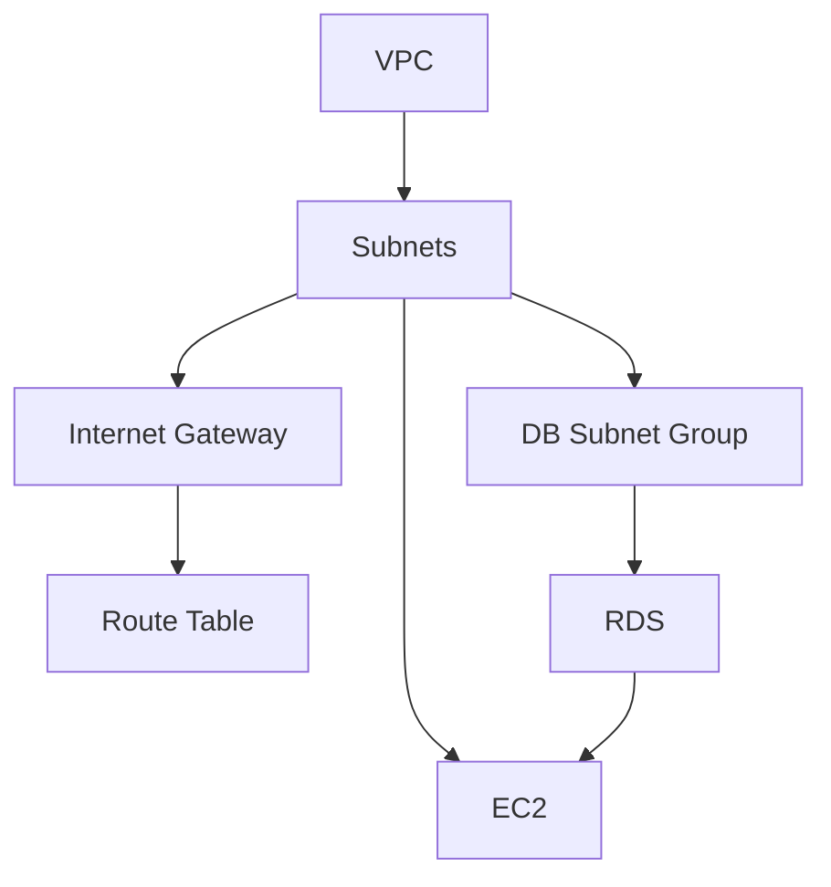

# Terraform - Moodle Infrastructure on AWS

> Infraestrutura completa como código (IaC) para provisionar Moodle 4.x na AWS com EC2, RDS PostgreSQL, VPC privada e documentação extensiva.

## 📋 Índice

1. [Visão Geral](#-visão-geral)
2. [Pré-requisitos](#-pré-requisitos)
3. [Quick Start](#-quick-start-15-minutos)
4. [Arquitetura](#️-arquitetura)
5. [Estrutura de Arquivos](#-estrutura-de-arquivos)
6. [Recursos AWS Criados](#-recursos-aws-criados)
7. [Guia de Deploy Detalhado](#-guia-de-deploy-detalhado)
8. [Configuração de Variáveis](#️-configuração-de-variáveis)
9. [Segurança](#-segurança)
10. [Custos](#-custos-estimados)
11. [Comandos Úteis (Makefile)](#-comandos-úteis-makefile)
12. [Troubleshooting](#-troubleshooting)
13. [Arquitetura Técnica](#️-arquitetura-técnica-decisões-de-design)
14. [Checklist de Deploy](#-checklist-de-deploy)
15. [Manutenção e Operação](#-manutenção-e-operação)

---

## 🎯 Visão Geral

Este projeto provisiona automaticamente uma infraestrutura completa para rodar o Moodle 4.x na AWS Learn Lab, incluindo:

- **VPC isolada** com subnets públicas e privadas
- **EC2 Instance** (t3.medium) com Docker + Moodle
- **RDS PostgreSQL 15** (db.t3.micro) em subnet privada
- **Security Groups** configurados com princípio de menor privilégio
- **Criptografia em repouso** (EC2 e RDS)
- **Alta disponibilidade** preparada para expansão futura

**Tempo estimado de deploy:** 10-12 minutos  
**Custo estimado:** ~$50/mês (AWS Learn Lab oferece créditos)

---

## 📋 Pré-requisitos

### Ferramentas Necessárias

- ✅ **Terraform** >= 1.5.0
  ```bash
  terraform --version
  ```

- ✅ **AWS CLI** configurado
  ```bash
  aws sts get-caller-identity
  ```

- ✅ **AWS Learn Lab** ativo
  - Lab iniciado
  - Credenciais AWS CLI baixadas
  - Credenciais em `~/.aws/credentials`

- ✅ **Par de chaves SSH** criado no EC2
  ```bash
  # Verificar
  ls ~/.ssh/vockey.pem
  chmod 400 ~/.ssh/vockey.pem
  ```

### Instalar Terraform (se necessário)

**Ubuntu/Debian:**
```bash
wget -O- https://apt.releases.hashicorp.com/gpg | sudo gpg --dearmor -o /usr/share/keyrings/hashicorp-archive-keyring.gpg
echo "deb [signed-by=/usr/share/keyrings/hashicorp-archive-keyring.gpg] https://apt.releases.hashicorp.com $(lsb_release -cs) main" | sudo tee /etc/apt/sources.list.d/hashicorp.list
sudo apt update && sudo apt install terraform
```

---

## 🚀 Quick Start (15 minutos)

### Comandos Rápidos

```bash
cd terraform

# 1. Configurar variáveis
cp terraform.tfvars.example terraform.tfvars
vim terraform.tfvars  # Configure db_password e ssh_allowed_cidr

# 2. Inicializar e aplicar
terraform init
terraform plan -out=tfplan
terraform apply tfplan

# 3. Aguardar ~10 minutos e obter URL
terraform output moodle_url
```

### Usando Makefile (Recomendado)

```bash
make help      # Ver todos os comandos
make setup     # Criar terraform.tfvars
make init      # Inicializar Terraform
make plan      # Criar plano
make apply     # Aplicar infraestrutura
make output    # Ver instruções de conexão
make ssh       # Conectar via SSH
make logs      # Ver logs do Moodle
make destroy   # Destruir tudo
```

**Credenciais padrão do Moodle:**
- Username: `admin`
- Password: `Admin123!`

---

## 🏗️ Arquitetura

### Diagrama

```
┌─────────────────────────────────────────────────────────────┐
│                         AWS VPC                              │
│                      (10.0.0.0/16)                           │
│                                                              │
│  ┌────────────────────────────────────────────────────┐     │
│  │  Public Subnet (10.0.1.0/24) - us-east-1a         │     │
│  │                                                     │     │
│  │  ┌─────────────────────────────┐                   │     │
│  │  │   EC2 Instance (t3.medium)  │                   │     │
│  │  │   - Amazon Linux 2023       │                   │     │
│  │  │   - Docker + Docker Compose │                   │     │
│  │  │   - Moodle 4.x              │                   │     │
│  │  └─────────────┬───────────────┘                   │     │
│  └────────────────┼───────────────────────────────────┘     │
│                   │                                          │
│                   │ Port 5432                                │
│                   │                                          │
│  ┌────────────────▼───────────────────────────────────┐     │
│  │  Private Subnet A (10.0.2.0/24) - us-east-1a      │     │
│  │                                                     │     │
│  │  ┌─────────────────────────────┐                   │     │
│  │  │  RDS PostgreSQL 15          │                   │     │
│  │  │  (db.t3.micro)              │                   │     │
│  │  └─────────────────────────────┘                   │     │
│  └─────────────────────────────────────────────────────┘     │
│                                                              │
│  ┌─────────────────────────────────────────────────────┐     │
│  │  Private Subnet B (10.0.3.0/24) - us-east-1b      │     │
│  │  (Para DB Subnet Group - 2 AZs obrigatórias)      │     │
│  └─────────────────────────────────────────────────────┘     │
└─────────────────────────────────────────────────────────────┘
```

### Fluxo de Dados

```
Internet → IGW → Route Table → Public Subnet → EC2 (Moodle)
                                                  ↓
                                      RDS (Private Subnet)
```

O RDS **nunca** é exposto à internet. Apenas a EC2 pode acessá-lo.

---

## 📁 Estrutura de Arquivos

```
terraform/
├── 📄 main.tf                      # Orquestração principal
├── 📄 variables.tf                 # Definição de variáveis
├── 📄 outputs.tf                   # Outputs da infraestrutura
├── 📄 terraform.tfvars.example     # Template de configuração
├── 📄 backend.tf.example           # Template backend S3
├── 📄 .gitignore                   # Ignora arquivos sensíveis
│
├── 📄 README.md                    # Esta documentação
├── 📄 Makefile                     # Comandos facilitadores
├── 📄 validate.sh                  # Script de validação
│
└── 📁 modules/                     # Módulos Terraform
    │
    ├── 📁 networking/              # VPC, Subnets, IGW
    │   ├── main.tf
    │   ├── variables.tf
    │   └── outputs.tf
    │
    ├── 📁 compute/                 # EC2 + Security Group
    │   ├── main.tf
    │   ├── variables.tf
    │   ├── outputs.tf
    │   └── user_data.sh            # Instala Docker + Moodle
    │
    └── 📁 database/                # RDS PostgreSQL
        ├── main.tf
        ├── variables.tf
        └── outputs.tf
```

**Total:** 26 arquivos  
**Linhas de código Terraform:** ~800  
**Linhas de documentação:** Você está lendo ela 😉

---

## 📊 Recursos AWS Criados

### Resumo

| Categoria | Recursos | Quantidade |
|-----------|----------|------------|
| **Networking** | VPC, Subnets (3), IGW, Route Table, RT Association | 7 |
| **Security** | Security Groups (2), SG Rule (1) | 3 |
| **Compute** | EC2 Instance | 1 |
| **Database** | RDS PostgreSQL, DB Subnet Group | 2 |
| **Total** | | **13** |

### Detalhamento

#### 🌐 Networking (Módulo: `networking`)

| Recurso | Tipo | Configuração |
|---------|------|--------------|
| VPC | `aws_vpc` | CIDR 10.0.0.0/16, DNS habilitado |
| Internet Gateway | `aws_internet_gateway` | Attached à VPC |
| Public Subnet | `aws_subnet` | 10.0.1.0/24, us-east-1a, auto-assign IP |
| Private Subnet A | `aws_subnet` | 10.0.2.0/24, us-east-1a |
| Private Subnet B | `aws_subnet` | 10.0.3.0/24, us-east-1b |
| Route Table | `aws_route_table` | Rota 0.0.0.0/0 → IGW |
| RT Association | `aws_route_table_association` | Associa RT à Public Subnet |

#### 🖥️ Compute (Módulo: `compute`)

| Recurso | Tipo | Configuração |
|---------|------|--------------|
| EC2 Instance | `aws_instance` | t3.medium, 2 vCPUs, 4GB RAM, 30GB gp3 |
| AMI | Amazon Linux 2023 | Última versão via data source |
| IAM Profile | LabInstanceProfile | Via data source (Learn Lab) |
| Security Group | `aws_security_group` | HTTP (80), SSH (22) |

**Software instalado (user_data.sh):**
- Docker 24+
- Docker Compose v2
- Moodle 4.x (container bitnami/moodle:4)

#### 🗄️ Database (Módulo: `database`)

| Recurso | Tipo | Configuração |
|---------|------|--------------|
| RDS Instance | `aws_db_instance` | PostgreSQL 15.4, db.t3.micro, 20GB gp3 |
| DB Subnet Group | `aws_db_subnet_group` | Private Subnets A + B |
| Security Group | `aws_security_group` | TCP 5432 apenas de EC2 SG |
| SG Rule | `aws_security_group_rule` | Ingress de EC2 → RDS |

**Configurações RDS:**
- Multi-AZ: No (para reduzir custos)
- Publicly Accessible: No
- Encrypted: Yes
- Backup Retention: 7 dias
- Enhanced Monitoring: 60s

---

## 🛠️ Guia de Deploy Detalhado

### Passo 1: Preparação

```bash
# Clone o repositório
git clone <repo-url>
cd implement_Moodle/terraform

# Verifique ferramentas
terraform --version  # Deve ser >= 1.5.0
aws sts get-caller-identity  # Deve retornar Account ID
```

### Passo 2: Configuração

```bash
# Crie arquivo de variáveis
cp terraform.tfvars.example terraform.tfvars

# Edite (OBRIGATÓRIO)
vim terraform.tfvars
```

**Configure no mínimo:**
- `db_password` - Senha forte (≥8 caracteres)
- `ssh_allowed_cidr` - Seu IP/32 (recomendado)

**Obter seu IP:**
```bash
curl -s ifconfig.me
# Use: <SEU_IP>/32
```

### Passo 3: Validação

```bash
# Executar script de validação
chmod +x validate.sh
./validate.sh

# Ou manualmente
terraform fmt -recursive
terraform init
terraform validate
```

### Passo 4: Planejamento

```bash
# Criar plano de execução
terraform plan -out=tfplan

# Revisar: deve mostrar ~13 recursos a criar
```

**O que esperar:**
```
Plan: 13 to add, 0 to change, 0 to destroy.
```

### Passo 5: Aplicação

```bash
# Aplicar infraestrutura
terraform apply tfplan

# ⏱️ Aguarde 8-12 minutos
```

**Progresso esperado:**
1. Networking (VPC, Subnets) - 2 min
2. Database (RDS) - 5-7 min
3. Compute (EC2) - 2-3 min
4. Container Moodle - 3-5 min (após EC2)

### Passo 6: Verificação

```bash
# Ver outputs
terraform output

# Obter URL do Moodle
EC2_DNS=$(terraform output -raw ec2_public_dns)
echo "http://$EC2_DNS"

# Health check (aguarde ~5 min após apply)
cd ../scripts
./health-check.sh $EC2_DNS
```

### Passo 7: Acesso

```bash
# Abrir no navegador
open http://$EC2_DNS
# ou
xdg-open http://$EC2_DNS

# Login:
# Username: admin
# Password: Admin123!
```

---

## ⚙️ Configuração de Variáveis

### Variáveis Obrigatórias

```hcl
# terraform.tfvars

# ⚠️ OBRIGATÓRIO: Altere esta senha!
db_password = "SuaSenhaForte123!"

# 🔒 RECOMENDADO: Restrinja ao seu IP
ssh_allowed_cidr = "203.0.113.45/32"  # Substitua pelo seu IP

# Verifique o nome da sua chave SSH
ec2_key_name = "vockey"
```

### Variáveis Opcionais

```hcl
# Região AWS
aws_region = "us-east-1"

# Ambiente
environment = "dev"

# Networking
vpc_cidr = "10.0.0.0/16"
public_subnet_cidr = "10.0.1.0/24"
private_subnet_a_cidr = "10.0.2.0/24"
private_subnet_b_cidr = "10.0.3.0/24"

# Compute
ec2_instance_type = "t3.medium"

# Database
db_instance_class = "db.t3.micro"
db_name = "moodle"
db_username = "moodleuser"
db_allocated_storage = 20
```

### Todas as Variáveis

| Variável | Tipo | Padrão | Descrição |
|----------|------|--------|-----------|
| `aws_region` | string | us-east-1 | Região AWS |
| `environment` | string | dev | Ambiente (dev/staging/prod) |
| `project_name` | string | moodle | Nome do projeto (tagging) |
| `vpc_cidr` | string | 10.0.0.0/16 | CIDR da VPC |
| `public_subnet_cidr` | string | 10.0.1.0/24 | CIDR subnet pública |
| `private_subnet_a_cidr` | string | 10.0.2.0/24 | CIDR subnet privada A |
| `private_subnet_b_cidr` | string | 10.0.3.0/24 | CIDR subnet privada B |
| `availability_zone_a` | string | us-east-1a | AZ A |
| `availability_zone_b` | string | us-east-1b | AZ B |
| `ec2_instance_type` | string | t3.medium | Tipo instância EC2 |
| `ec2_key_name` | string | vockey | Nome chave SSH |
| `ssh_allowed_cidr` | string | 0.0.0.0/0 | CIDR acesso SSH |
| `db_instance_class` | string | db.t3.micro | Classe instância RDS |
| `db_name` | string | moodle | Nome do banco |
| `db_username` | string | moodleuser | Usuário do banco |
| `db_password` | string | *required* | Senha do banco (sensível) |
| `db_allocated_storage` | number | 20 | Storage GB (20-100) |

---

## 🔐 Segurança

### Implementações de Segurança

#### 1. Network Segmentation

```
Internet → IGW → Public Subnet → EC2
                                  ↓
                          RDS (Private Subnet)
```

- ✅ RDS **nunca** acessível da internet
- ✅ EC2 em subnet pública para acesso HTTP
- ✅ Security Groups com regras específicas

#### 2. Security Groups

**EC2 Security Group:**
```hcl
Ingress:
  - Port 80 (HTTP) ← 0.0.0.0/0
  - Port 22 (SSH) ← configurável (ssh_allowed_cidr)

Egress:
  - All traffic → 0.0.0.0/0 (para Docker Hub, RDS)
```

**RDS Security Group:**
```hcl
Ingress:
  - Port 5432 (PostgreSQL) ← EC2 Security Group APENAS

Egress:
  - All traffic → 0.0.0.0/0
```

#### 3. Criptografia

```hcl
# EC2 - EBS Volume
root_block_device {
  encrypted = true
}

# RDS
storage_encrypted = true
```

- ✅ Criptografia em repouso (AWS-managed keys)
- ✅ Sem custo adicional

#### 4. IMDSv2

```hcl
metadata_options {
  http_tokens = "required"  # IMDSv2 obrigatório
}
```

- ✅ Proteção contra ataques SSRF

#### 5. Variáveis Sensíveis

```hcl
variable "db_password" {
  sensitive = true  # Não aparece em logs
}
```

- ✅ Senhas não aparecem em `terraform plan`
- ✅ Não logadas em outputs

#### 6. .gitignore

```gitignore
*.tfvars          # Não commite senhas
*.tfstate         # Não commite estado
.terraform/       # Não commite cache
```

### Recomendações de Segurança

**Para Produção:**

1. ✅ **SSH Restrito**
   ```hcl
   ssh_allowed_cidr = "203.0.113.45/32"  # Apenas seu IP
   ```

2. ✅ **Backend S3 Criptografado**
   ```hcl
   backend "s3" {
     encrypt = true
   }
   ```

3. ✅ **RDS Multi-AZ**
   ```hcl
   multi_az = true
   ```

4. ✅ **Secrets Manager**
   ```hcl
   # Armazenar db_password no AWS Secrets Manager
   data "aws_secretsmanager_secret_version" "db_password" {
     secret_id = "moodle/db-password"
   }
   ```

5. ✅ **WAF + ALB**
   - Adicionar AWS WAF (fora do Learn Lab)
   - HTTPS com ACM (fora do Learn Lab)

### Limitações do AWS Learn Lab

⚠️ **O que NÃO está disponível:**

- ❌ HTTPS (ACM bloqueado)
- ❌ CloudFront (bloqueado)
- ❌ Criação de IAM Roles
- ❌ Route 53 (DNS gerenciado)
- ❌ WAF

**Alternativas implementadas:**
- ✅ DNS público do EC2 (temporário)
- ✅ LabRole via data source
- ✅ HTTP na porta 80

---

## 💰 Custos Estimados

### Custos Mensais (us-east-1)

| Recurso | Tipo | Custo/hora | Custo/mês (730h) |
|---------|------|------------|------------------|
| **EC2 Instance** | t3.medium | $0.0416 | $30.37 |
| **EBS Volume** | 30 GB gp3 | - | $2.40 |
| **RDS Instance** | db.t3.micro | $0.018 | $13.14 |
| **RDS Storage** | 20 GB gp3 | - | $2.30 |
| **RDS Backups** | 7 dias (~20GB) | - | $0.95 |
| **Enhanced Monitoring** | 60s interval | - | $1.00 |
| **Data Transfer** | Primeiros 100GB | - | $0.00 |
| **NAT Gateway** | N/A (não usado) | - | $0.00 |
| | | **Total** | **~$50.16/mês** |

### Custos Diários e Horários

- **Diário:** ~$1.67/dia
- **Horário:** ~$0.07/hora

### Estimativa de Custo do Projeto (AWS Learn Lab)

```
Desenvolvimento (30 dias): ~$50
Testes (7 dias):          ~$12
Deploy final (1 dia):      ~$2

Total estimado:           ~$64
```

**AWS Learn Lab:** Oferece créditos educacionais (geralmente $100+)

### Otimizações de Custo

**Para Ambientes de Desenvolvimento:**

1. **Parar EC2 quando não usar:**
   ```bash
   aws ec2 stop-instances --instance-ids $(terraform output -raw ec2_instance_id)
   # Economia: ~$30/mês
   ```

2. **Usar db.t3.micro Burstable:**
   - Já implementado
   - Ideal para cargas não-constantes

3. **Reduzir backup retention:**
   ```hcl
   backup_retention_period = 1  # Em vez de 7
   ```

4. **Destruir quando não precisar:**
   ```bash
   terraform destroy
   # Custo: $0
   ```

### Estimativa de Custos com Infracost

```bash
# Instalar infracost
curl -fsSL https://raw.githubusercontent.com/infracost/infracost/master/scripts/install.sh | sh

# Estimar custos
cd terraform
infracost breakdown --path .

# Comparar mudanças
infracost diff --path .
```

---

## 🛠️ Comandos Úteis (Makefile)

### Ver Todos os Comandos

```bash
make help
```

### Comandos de Deploy

```bash
make init      # Inicializa Terraform (download providers)
make validate  # Valida sintaxe
make fmt       # Formata código
make check     # fmt + validate
make plan      # Cria plano de execução
make apply     # Aplica infraestrutura (requer plan)
make output    # Mostra outputs e instruções
```

### Comandos de Acesso

```bash
make ssh       # SSH na instância EC2
make logs      # Ver logs do container Moodle
make health    # Executar health check
```

### Comandos de Gerenciamento

```bash
make status    # Ver status dos recursos
make refresh   # Atualizar state com estado real AWS
make graph     # Gerar gráfico de dependências (requer graphviz)
make cost      # Estimar custos (requer infracost)
```

### Comandos de Limpeza

```bash
make destroy   # Destruir toda infraestrutura
make clean     # Limpar arquivos temporários (.terraform, tfplan)
```

### Comandos de Setup

```bash
make setup     # Criar terraform.tfvars do exemplo
```

### Exemplos de Uso

```bash
# Deploy completo
make init && make plan && make apply

# Conectar via SSH e ver logs
make ssh
# Dentro da EC2:
sudo docker logs moodle --follow

# Verificar saúde do Moodle
make health

# Destruir e limpar tudo
make destroy && make clean
```

---

## 🔍 Troubleshooting

### Problema: Terraform init falha

**Sintomas:**
```
Error: Failed to download provider
```

**Solução:**
```bash
# Limpar cache e reinicializar
rm -rf .terraform .terraform.lock.hcl
terraform init
```

---

### Problema: Credenciais AWS não encontradas

**Sintomas:**
```
Error: NoCredentialProviders
```

**Solução:**
```bash
# Verificar credenciais
aws sts get-caller-identity

# Reconfigurar se necessário
aws configure

# Ou copiar credenciais do AWS Learn Lab
cat > ~/.aws/credentials <<EOF
[default]
aws_access_key_id = YOUR_ACCESS_KEY
aws_secret_access_key = YOUR_SECRET_KEY
aws_session_token = YOUR_SESSION_TOKEN
EOF
```

---

### Problema: EC2 não conecta ao RDS

**Sintomas:**
- Moodle mostra erro de conexão com banco de dados
- Logs mostram "Connection refused"

**Diagnóstico:**
```bash
# 1. Verificar endpoint do RDS
terraform output rds_endpoint

# 2. SSH na EC2
ssh -i ~/.ssh/vockey.pem ec2-user@$(terraform output -raw ec2_public_ip)

# 3. Testar conectividade
docker run --rm postgres:15 pg_isready -h <RDS_ENDPOINT> -U moodleuser

# 4. Verificar Security Groups
aws ec2 describe-security-groups \
  --group-ids $(terraform output -raw ec2_security_group_id) \
  --query 'SecurityGroups[0].IpPermissionsEgress'
```

**Soluções:**
1. Aguardar RDS ficar "available" (pode levar 5-7 min)
2. Verificar se RDS SG permite ingresso do EC2 SG
3. Verificar se senha em `terraform.tfvars` está correta

---

### Problema: Moodle não carrega (timeout)

**Sintomas:**
- Navegador mostra "Connection timeout"
- curl falha com timeout

**Diagnóstico:**
```bash
# 1. Verificar se EC2 está rodando
aws ec2 describe-instances \
  --instance-ids $(terraform output -raw ec2_instance_id) \
  --query 'Reservations[0].Instances[0].State.Name'

# 2. SSH e verificar Docker
ssh -i ~/.ssh/vockey.pem ec2-user@$(terraform output -raw ec2_public_ip)
sudo docker ps
sudo docker logs moodle --tail 100

# 3. Verificar user-data executou
sudo cat /var/log/user-data.log
```

**Soluções:**
1. **Aguardar mais tempo** (container leva ~5 min para inicializar)
2. **Verificar Security Group porta 80:**
   ```bash
   aws ec2 describe-security-groups \
     --group-ids $(terraform output -raw ec2_security_group_id)
   ```
3. **Reiniciar container:**
   ```bash
   ssh -i ~/.ssh/vockey.pem ec2-user@$(terraform output -raw ec2_public_ip)
   cd /opt/moodle
   sudo docker-compose restart
   ```

---

### Problema: Erro de dependência circular

**Sintomas:**
```
Error: Cycle: module.compute, module.database
```

**Solução:**
- Já corrigido na arquitetura atual
- Database é criado primeiro, depois EC2
- Se ainda ocorrer:
  ```bash
  terraform state rm module.compute
  terraform apply
  ```

---

### Problema: "Resource already exists"

**Sintomas:**
```
Error: VPC with ID vpc-xxx already exists
```

**Solução:**
```bash
# Importar recurso existente
terraform import aws_vpc.main vpc-xxx

# Ou destruir recurso antigo manualmente
aws ec2 delete-vpc --vpc-id vpc-xxx

# Ou usar novo workspace
terraform workspace new dev2
```

---

### Problema: Terraform state corrompido

**Sintomas:**
```
Error: state snapshot was created by Terraform v1.x.x
```

**Solução:**
```bash
# Backup do state
cp terraform.tfstate terraform.tfstate.backup

# Atualizar state
terraform state replace-provider

# Ou recriar do zero
rm terraform.tfstate*
terraform import ...
```

---

### Problema: SSH falha (Permission denied)

**Sintomas:**
```
Permission denied (publickey)
```

**Solução:**
```bash
# 1. Verificar permissões da chave
chmod 400 ~/.ssh/vockey.pem

# 2. Usar usuário correto (ec2-user)
ssh -i ~/.ssh/vockey.pem ec2-user@<IP>

# 3. Verificar se chave está correta
terraform output ec2_instance_id
aws ec2 describe-instances \
  --instance-ids <INSTANCE_ID> \
  --query 'Reservations[0].Instances[0].KeyName'
```

---

### Problema: Custos acima do esperado

**Diagnóstico:**
```bash
# Ver recursos rodando
aws ec2 describe-instances --filters "Name=instance-state-name,Values=running"
aws rds describe-db-instances --query 'DBInstances[*].[DBInstanceIdentifier,DBInstanceStatus]'

# Estimar custos
infracost breakdown --path .
```

**Soluções:**
1. **Parar EC2 quando não usar:**
   ```bash
   aws ec2 stop-instances --instance-ids $(terraform output -raw ec2_instance_id)
   ```
2. **Destruir ambiente de teste:**
   ```bash
   terraform destroy
   ```

---

### Problema: DNS público não resolve

**Sintomas:**
- `terraform output ec2_public_dns` retorna DNS
- Mas navegador não consegue acessar

**Solução:**
```bash
# 1. Aguardar propagação DNS (1-2 min)
sleep 120

# 2. Usar IP em vez de DNS
curl http://$(terraform output -raw ec2_public_ip)

# 3. Verificar DNS externamente
nslookup $(terraform output -raw ec2_public_dns)
dig $(terraform output -raw ec2_public_dns)
```

---

### Problema: Logs mostram erro de memória

**Sintomas:**
```
FATAL: out of memory
```

**Solução:**
1. **Aumentar tipo de instância** (temporariamente):
   ```hcl
   # terraform.tfvars
   ec2_instance_type = "t3.large"  # 2 vCPUs, 8GB RAM
   ```
   ```bash
   terraform apply
   ```

2. **Adicionar swap:**
   ```bash
   ssh -i ~/.ssh/vockey.pem ec2-user@$(terraform output -raw ec2_public_ip)
   sudo dd if=/dev/zero of=/swapfile bs=1M count=2048
   sudo chmod 600 /swapfile
   sudo mkswap /swapfile
   sudo swapon /swapfile
   ```

---

### Scripts de Debug

```bash
# Script completo de diagnóstico
cat > debug.sh <<'EOF'
#!/bin/bash
echo "=== Terraform Outputs ==="
terraform output

echo -e "\n=== EC2 Status ==="
aws ec2 describe-instances \
  --instance-ids $(terraform output -raw ec2_instance_id) \
  --query 'Reservations[0].Instances[0].[State.Name,PublicDnsName,PublicIpAddress]'

echo -e "\n=== RDS Status ==="
aws rds describe-db-instances \
  --db-instance-identifier $(terraform output -raw rds_instance_id) \
  --query 'DBInstances[0].[DBInstanceStatus,Endpoint.Address]'

echo -e "\n=== Security Groups ==="
aws ec2 describe-security-groups \
  --group-ids $(terraform output -raw ec2_security_group_id)

echo -e "\n=== SSH Test ==="
ssh -i ~/.ssh/vockey.pem -o ConnectTimeout=5 \
  ec2-user@$(terraform output -raw ec2_public_ip) \
  'echo "SSH OK" && docker ps'

echo -e "\n=== HTTP Test ==="
curl -s -o /dev/null -w "%{http_code}" \
  http://$(terraform output -raw ec2_public_dns)
EOF

chmod +x debug.sh
./debug.sh
```

---

## 🏗️ Arquitetura Técnica (Decisões de Design)

### Por Que Módulos?

**Decisão:** Dividir infraestrutura em 3 módulos (networking, compute, database)

**Justificativa:**
- ✅ **Reusabilidade:** Módulos podem ser reutilizados em outros projetos
- ✅ **Manutenibilidade:** Mudanças isoladas em escopo específico
- ✅ **Testabilidade:** Cada módulo pode ser testado independentemente
- ✅ **Clareza:** Separação lógica de responsabilidades

**Alternativa rejeitada:** Monolito (tudo em `main.tf`)
- ❌ Difícil manutenção
- ❌ Dificulta testes
- ❌ Acoplamento alto

---

### Por Que Amazon Linux 2023?

**Decisão:** Usar Amazon Linux 2023 como AMI

**Justificativa:**
- ✅ **Suporte oficial AWS:** Mantida pela Amazon
- ✅ **Docker nativo:** Instalação simples via `dnf`
- ✅ **Otimizada para AWS:** Melhor performance
- ✅ **Suporte de longo prazo:** Updates garantidos
- ✅ **Compatibilidade:** User data script testado

**Alternativas consideradas:**
- Ubuntu 22.04: Mais popular, mas requer configurações extras
- Amazon Linux 2: Versão antiga, fim de suporte em 2025

---

### Por Que PostgreSQL 15?

**Decisão:** Usar PostgreSQL 15 em vez de MySQL/MariaDB

**Justificativa:**
- ✅ **Compatibilidade Docker:** Alinhado com ambiente local
- ✅ **Performance:** Melhor em queries complexas
- ✅ **Recursos avançados:** JSON nativo, extensões
- ✅ **Suporte Moodle:** Oficialmente suportado
- ✅ **Licença:** PostgreSQL License (mais permissiva)

**Alternativa considerada:**
- MySQL 8.0: Moodle funciona bem, mas menos recursos

---

### Por Que RDS em Subnet Privada?

**Decisão:** `publicly_accessible = false`

**Justificativa:**
- ✅ **Segurança:** Banco nunca exposto à internet
- ✅ **Best Practice AWS:** Defense in depth
- ✅ **Compliance:** Requisito para LGPD/GDPR
- ✅ **Ataque reduzido:** Precisa comprometer EC2 primeiro

**Desvantagem:**
- ❌ Não pode conectar diretamente de máquina local
- Solução: SSH tunnel via EC2

---

### Por Que t3.medium para EC2?

**Decisão:** Usar t3.medium (2 vCPUs, 4GB RAM)

**Justificativa:**
- ✅ **Requisitos Moodle:** Mínimo 2GB RAM recomendado
- ✅ **Docker overhead:** Containers precisam de recursos
- ✅ **Burstable:** Créditos CPU para picos
- ✅ **Custo-benefício:** ~$30/mês

**Alternativas:**
- t3.micro (1 vCPU, 1GB): Insuficiente para Moodle
- t3.small (2 vCPUs, 2GB): RAM limitada
- t3.large (2 vCPUs, 8GB): Overkill para dev

---

### Por Que db.t3.micro para RDS?

**Decisão:** Usar db.t3.micro (2 vCPUs, 1GB RAM)

**Justificativa:**
- ✅ **Menor instância disponível:** Minimiza custos
- ✅ **Ambiente educacional:** Carga baixa
- ✅ **Burstable:** Performance adequada para dev
- ✅ **Upgradeable:** Fácil escalar depois

**Limitação:**
- ⚠️ Performance limitada: Para produção, usar db.t3.small+

---

### Por Que Não Auto Scaling?

**Decisão:** Single EC2 sem Auto Scaling Group

**Justificativa:**
- ✅ **Restrição Learn Lab:** LabRole não tem permissão confiável para ASG
- ✅ **Escopo educacional:** HA não é requisito
- ✅ **Simplicidade:** Reduz complexidade
- ✅ **Custo:** Economiza recursos

**Para produção:** Implementar ASG + ALB

---

### Por Que Não HTTPS?

**Decisão:** HTTP na porta 80 (sem TLS/SSL)

**Justificativa:**
- ✅ **Restrição Learn Lab:** ACM bloqueado
- ✅ **CloudFront bloqueado:** Alternativa indisponível
- ✅ **Ambiente educacional:** Aceito pela especificação

**Para produção:**
```hcl
# Adicionar:
resource "aws_lb" "moodle" { ... }
resource "aws_acm_certificate" "moodle" { ... }
resource "aws_lb_listener" "https" { ... }
```

---

### Por Que User Data em vez de AMI customizada?

**Decisão:** Usar `user_data.sh` para setup

**Justificativa:**
- ✅ **Versionamento:** Script no Git, fácil de modificar
- ✅ **Transparência:** Tudo visível no código
- ✅ **Flexibilidade:** Fácil testar mudanças
- ✅ **Sem AMI management:** Não precisa manter AMIs

**Desvantagem:**
- ⚠️ Primeiro boot mais lento (~5 min)
- Solução: Para prod, criar AMI com Packer

---

### Por Que 2 Subnets Privadas?

**Decisão:** Private Subnet A (us-east-1a) + Private Subnet B (us-east-1b)

**Justificativa:**
- ✅ **Requisito AWS:** `aws_db_subnet_group` exige ≥2 AZs
- ✅ **Preparado para Multi-AZ:** Fácil habilitar depois

**Observação:**
- Private Subnet B fica ociosa (sem recursos)
- Apenas requisito técnico da AWS

---

### Por Que Criptografia em Repouso?

**Decisão:** `encrypted = true` em EBS e RDS

**Justificativa:**
- ✅ **Sem custo extra:** Gratuito na AWS
- ✅ **Compliance:** LGPD, GDPR, ISO 27001
- ✅ **Best practice:** Sempre criptografar
- ✅ **Proteção:** Contra acesso físico

---

### Por Que IMDSv2?

**Decisão:** `http_tokens = "required"`

**Justificativa:**
- ✅ **Segurança:** Proteção contra SSRF
- ✅ **Best practice AWS:** Recomendação oficial
- ✅ **Sem impacto:** Docker e apps modernas compatíveis

---

### Por Que Backend Local?

**Decisão:** State local por padrão (S3 opcional)

**Justificativa:**
- ✅ **Simplicidade:** Setup mais rápido
- ✅ **Single developer:** Não há conflitos
- ✅ **Learn Lab:** Ambiente temporário

**Para produção/equipe:**
```hcl
# Habilitar backend.tf
terraform {
  backend "s3" {
    bucket = "moodle-terraform-state"
    key    = "moodle/terraform.tfstate"
    region = "us-east-1"
    encrypt = true
    dynamodb_table = "moodle-terraform-locks"
  }
}
```

---

### Fluxo de Dependências



**Ordem de criação:**
1. Networking (independente)
2. Database (precisa de networking)
3. Compute (precisa de networking + database endpoint)

---

## ✅ Checklist de Deploy

Use este checklist para garantir um deploy bem-sucedido.

### 🔧 Pré-Deploy

**Ferramentas:**
- [ ] Terraform >= 1.5.0 instalado (`terraform --version`)
- [ ] AWS CLI configurado (`aws sts get-caller-identity`)
- [ ] AWS Learn Lab ativo (Lab iniciado)
- [ ] Credenciais AWS em `~/.aws/credentials`
- [ ] Par de chaves SSH criado (`~/.ssh/vockey.pem`)
- [ ] Permissão 400 na chave (`chmod 400 ~/.ssh/vockey.pem`)

**Configuração:**
- [ ] Repositório clonado
- [ ] `cd terraform/`
- [ ] `terraform.tfvars` criado (`cp terraform.tfvars.example terraform.tfvars`)
- [ ] `db_password` alterado em `terraform.tfvars`
- [ ] `ssh_allowed_cidr` configurado com seu IP (`curl ifconfig.me`)
- [ ] `ec2_key_name` corresponde à chave SSH

**Validação:**
- [ ] `./validate.sh` executado sem erros
- [ ] `terraform fmt -check -recursive` passou
- [ ] `terraform init` concluído
- [ ] `terraform validate` passou

### 🚀 Deploy

- [ ] `terraform plan -out=tfplan` executado
- [ ] Plano revisado: ~13 recursos a criar
- [ ] `terraform apply tfplan` executado
- [ ] Apply concluído sem erros (~10 min)
- [ ] Outputs capturados (`terraform output > outputs.txt`)

### ✅ Pós-Deploy

**Verificações Imediatas:**
- [ ] EC2 está "running" (`aws ec2 describe-instances ...`)
- [ ] RDS está "available" (`aws rds describe-db-instances ...`)
- [ ] DNS público acessível (`terraform output ec2_public_dns`)

**Aguardar ~5 minutos** (container inicializando)

**Verificação da Aplicação:**
- [ ] SSH funciona (`ssh -i ~/.ssh/vockey.pem ec2-user@<IP>`)
- [ ] Docker instalado (`ssh ... 'docker --version'`)
- [ ] Container rodando (`ssh ... 'docker ps | grep moodle'`)
- [ ] Logs sem erros críticos (`ssh ... 'sudo docker logs moodle --tail 50'`)

**Health Check:**
- [ ] `../scripts/health-check.sh <EC2_DNS>` retorna OK
- [ ] Moodle acessível no navegador (`http://<EC2_DNS>`)
- [ ] Login funciona (admin / Admin123!)

**Segurança:**
- [ ] RDS não é "publicly_accessible"
- [ ] EC2 SG permite apenas porta 80 e 22
- [ ] RDS SG permite apenas porta 5432 do EC2 SG
- [ ] Storage criptografado (EC2 e RDS)

**Documentação:**
- [ ] Outputs salvos (`terraform output -json > outputs.json`)
- [ ] Screenshot do Moodle funcionando
- [ ] `docs/architecture-design.md` atualizado

### 🧹 Limpeza (Opcional)

- [ ] Backup de dados importantes
- [ ] `terraform destroy` executado
- [ ] Recursos deletados verificados (`terraform state list` vazio)

### 📊 Critérios de Sucesso

Deploy considerado bem-sucedido quando **TODOS** itens abaixo forem ✅:

- ✅ Terraform apply: 0 erros
- ✅ EC2 Status: running
- ✅ RDS Status: available
- ✅ Health check: PASS
- ✅ Moodle acessível: HTTP 200
- ✅ Login admin: funcionando
- ✅ Tempo total: < 15 minutos

---

## 🔄 Manutenção e Operação

### Atualizar Infraestrutura

```bash
# 1. Modificar variáveis ou código
vim terraform.tfvars
vim main.tf

# 2. Validar mudanças
terraform fmt
terraform validate

# 3. Ver impacto
terraform plan

# 4. Aplicar
terraform apply
```

### Atualizar Apenas um Módulo

```bash
# Atualizar apenas compute
terraform apply -target=module.compute

# Atualizar apenas database
terraform apply -target=module.database
```

### Escalar Recursos

**Aumentar EC2:**
```hcl
# terraform.tfvars
ec2_instance_type = "t3.large"  # De t3.medium
```

**Aumentar RDS:**
```hcl
# terraform.tfvars
db_instance_class = "db.t3.small"  # De db.t3.micro
db_allocated_storage = 40          # De 20
```

Aplicar:
```bash
terraform apply
# ⏱️ RDS: downtime de ~5 min
# ⏱️ EC2: precisa recriar (downtime)
```

### Habilitar Multi-AZ RDS

```hcl
# modules/database/main.tf
resource "aws_db_instance" "moodle" {
  ...
  multi_az = true  # Adicionar
}
```

```bash
terraform apply
# ⏱️ ~10 min, sem downtime
```

### Adicionar Backups Automatizados

```bash
# Snapshot manual
aws rds create-db-snapshot \
  --db-instance-identifier moodle-postgres \
  --db-snapshot-identifier moodle-snapshot-$(date +%Y%m%d-%H%M%S)

# Ou via Terraform (já configurado)
# backup_retention_period = 7
```

### Monitoramento

**CloudWatch Metrics:**
```bash
# Ver métricas CPU EC2
aws cloudwatch get-metric-statistics \
  --namespace AWS/EC2 \
  --metric-name CPUUtilization \
  --dimensions Name=InstanceId,Value=$(terraform output -raw ec2_instance_id) \
  --start-time $(date -u -d '1 hour ago' +%Y-%m-%dT%H:%M:%S) \
  --end-time $(date -u +%Y-%m-%dT%H:%M:%S) \
  --period 300 \
  --statistics Average

# Ver métricas RDS
aws cloudwatch get-metric-statistics \
  --namespace AWS/RDS \
  --metric-name DatabaseConnections \
  --dimensions Name=DBInstanceIdentifier,Value=moodle-postgres \
  --start-time $(date -u -d '1 hour ago' +%Y-%m-%dT%H:%M:%S) \
  --end-time $(date -u +%Y-%m-%dT%H:%M:%S) \
  --period 300 \
  --statistics Average
```

### Acessar Logs

**EC2:**
```bash
# SSH
ssh -i ~/.ssh/vockey.pem ec2-user@$(terraform output -raw ec2_public_ip)

# Logs user-data
sudo cat /var/log/user-data.log

# Logs Docker
sudo docker logs moodle --follow
sudo docker logs moodle --tail 100
```

**RDS:**
```bash
# Baixar logs (habilitado via enabled_cloudwatch_logs_exports)
aws rds download-db-log-file-portion \
  --db-instance-identifier moodle-postgres \
  --log-file-name error/postgresql.log.2024-01-15-12
```

### Conectar ao Banco de Dados

**Via SSH Tunnel:**
```bash
# 1. Criar tunnel
ssh -i ~/.ssh/vockey.pem -N -L 5432:<RDS_ENDPOINT>:5432 \
  ec2-user@$(terraform output -raw ec2_public_ip)

# 2. Em outro terminal, conectar
psql -h localhost -U moodleuser -d moodle
```

**Diretamente da EC2:**
```bash
ssh -i ~/.ssh/vockey.pem ec2-user@$(terraform output -raw ec2_public_ip)
docker run -it --rm postgres:15 psql \
  -h <RDS_ENDPOINT> \
  -U moodleuser \
  -d moodle
```

### Backup e Restore

**Backup:**
```bash
# 1. Snapshot RDS (automático via Terraform)
# 2. Backup manual:
ssh -i ~/.ssh/vockey.pem ec2-user@$(terraform output -raw ec2_public_ip)
docker exec moodle pg_dump \
  -h <RDS_ENDPOINT> \
  -U moodleuser \
  moodle > moodle_backup_$(date +%Y%m%d).sql
```

**Restore:**
```bash
# 1. Restaurar RDS de snapshot (via console)
# 2. Restaurar SQL:
ssh -i ~/.ssh/vockey.pem ec2-user@$(terraform output -raw ec2_public_ip)
docker exec -i moodle psql \
  -h <RDS_ENDPOINT> \
  -U moodleuser \
  moodle < moodle_backup_20240115.sql
```

### Workspaces (Múltiplos Ambientes)

```bash
# Criar workspaces
terraform workspace new dev
terraform workspace new staging
terraform workspace new prod

# Listar
terraform workspace list

# Alternar
terraform workspace select dev

# Deploy por ambiente
terraform apply -var-file=dev.tfvars
```

### Importar Recursos Existentes

```bash
# Importar VPC existente
terraform import module.networking.aws_vpc.main vpc-0123456789abcdef

# Importar EC2
terraform import module.compute.aws_instance.moodle i-0123456789abcdef

# Importar RDS
terraform import module.database.aws_db_instance.moodle moodle-postgres
```

### Migrar State para S3

```bash
# 1. Criar bucket e tabela (ver backend.tf.example)
aws s3api create-bucket --bucket moodle-terraform-state-$(aws sts get-caller-identity --query Account --output text) --region us-east-1
aws dynamodb create-table --table-name moodle-terraform-locks ...

# 2. Renomear backend.tf.example para backend.tf
mv backend.tf.example backend.tf
vim backend.tf  # Ajustar bucket name

# 3. Migrar
terraform init -migrate-state
```

---

## 📚 Recursos Adicionais

### Documentação Oficial

- [Terraform Documentation](https://developer.hashicorp.com/terraform)
- [Terraform AWS Provider](https://registry.terraform.io/providers/hashicorp/aws/latest/docs)
- [AWS Well-Architected Framework](https://aws.amazon.com/architecture/well-architected/)
- [Moodle Documentation](https://docs.moodle.org/)
- [PostgreSQL 15 Documentation](https://www.postgresql.org/docs/15/)

### Tutoriais e Guias

- [Terraform Best Practices](https://www.terraform-best-practices.com/)
- [AWS Security Best Practices](https://docs.aws.amazon.com/security/)
- [Moodle System Requirements](https://docs.moodle.org/404/en/System_requirements)

### Ferramentas Recomendadas

- **tflint:** Linter para Terraform
  ```bash
  brew install tflint
  tflint --init
  tflint
  ```

- **terraform-docs:** Gera documentação automática
  ```bash
  brew install terraform-docs
  terraform-docs markdown table . > TERRAFORM_DOCS.md
  ```

- **infracost:** Estima custos
  ```bash
  brew install infracost
  infracost breakdown --path .
  ```

- **checkov:** Security scanning
  ```bash
  pip install checkov
  checkov -d .
  ```

### Community e Suporte

- [Terraform Community Forum](https://discuss.hashicorp.com/c/terraform-core/)
- [AWS re:Post](https://repost.aws/)
- [Moodle Community Forums](https://moodle.org/course/)
- [Stack Overflow - Terraform](https://stackoverflow.com/questions/tagged/terraform)

---

## 📊 Estatísticas do Projeto

```
Total de arquivos:             26
Arquivos Terraform (.tf):      12
Módulos:                        3
Recursos AWS criados:          ~13
Linhas de código Terraform:   ~800
Linhas de documentação:       ~2500
Linhas de bash (user_data):   ~150
Tempo de deploy:              10-12 min
Custo mensal estimado:        ~$50 USD
```

---

## 📝 Próximos Passos

Após deploy bem-sucedido:

1. ✅ **Alterar senha admin Moodle**
   - Login como admin
   - Site administration → Users → Accounts → Edit profile

2. ✅ **Configurar cursos**
   - Criar categorias
   - Adicionar cursos
   - Matricular usuários

3. ✅ **Documentar arquitetura**
   - Preencher `docs/architecture-design.md`
   - Adicionar diagramas
   - Documentar decisões

4. ✅ **Configurar backups automáticos** (se produção)
   - Habilitar snapshots diários RDS
   - Backup de volumes Moodle

5. ✅ **Implementar monitoramento**
   - CloudWatch Dashboards
   - Alarmes (CPU, memória, disco)
   - SNS para notificações

6. ✅ **Considerar melhorias** (fora do Learn Lab)
   - HTTPS com ALB + ACM
   - CloudFront para CDN
   - Auto Scaling Group
   - ElastiCache (Redis/Memcached)

---

## 🤝 Contribuindo

Para modificar este projeto:

1. **Fork o repositório**
2. **Crie uma branch:**
   ```bash
   git checkout -b feature/minha-melhoria
   ```
3. **Modifique arquivos `.tf`**
4. **Valide:**
   ```bash
   terraform fmt -recursive
   terraform validate
   ```
5. **Teste:**
   ```bash
   terraform plan
   ```
6. **Commit:**
   ```bash
   git commit -m "feat: adiciona melhoria X"
   ```
7. **Push:**
   ```bash
   git push origin feature/minha-melhoria
   ```
8. **Abra Pull Request**

---

## 🐛 Reportar Issues

Encontrou um bug? Abra uma issue com:

- **Descrição:** O que aconteceu?
- **Passos para reproduzir:** Como recriar o erro?
- **Comportamento esperado:** O que deveria acontecer?
- **Logs:** Output do Terraform, logs do Docker
- **Ambiente:** Versão do Terraform, AWS region, etc

---

## 📜 Licença

Este projeto está sob a licença especificada no arquivo `LICENSE` na raiz do repositório.

---

## 🎉 Conclusão

Você agora tem uma infraestrutura completa e funcional para rodar o Moodle na AWS!

**Comandos finais:**

```bash
# Ver status
terraform output

# URL do Moodle
terraform output moodle_url

# SSH
make ssh

# Logs
make logs

# Health check
make health
```

**Dúvidas?** Consulte a seção [Troubleshooting](#-troubleshooting) ou abra uma issue.

**Bom deploy! 🚀**

---

**Última atualização:** 2024  
**Versão:** 1.0.0  
**Terraform:** >= 1.5.0  
**AWS Provider:** ~> 5.0  
**Status:** ✅ Pronto para uso

---

_Criado com ❤️ para o projeto de DevOps - Moodle Infrastructure_
